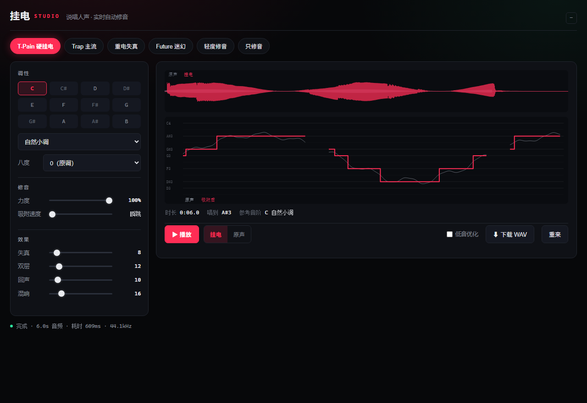

# 挂电 Studio

说唱人声实时自动修音。**双击 `guadian-studio.html` 就能用，不用装任何东西。**

**在线版（手机/电脑都能开，麦克风可直接用）：**
### 👉 https://chouxiangboshi.github.io/autotune-studio/



- 实时监听：对着麦唱，耳机里立刻是挂电后的声音，方便找调
- 录完/传进来：跑一遍离线高精度处理，导出 WAV 直接拖进 DAW
- 全本地运算，声音不出你的电脑（在线版也一样，音频不经过任何服务器）

---

## 一、怎么用

### 路子 0：装成桌面应用（推荐，一次搞定）

1. 用 Chrome 或 Edge 打开在线版
2. 地址栏右侧会出现一个**安装图标**（小显示器带下箭头）；没看到就点右上角 ⋮ →「应用」→「安装此网站」
3. 桌面和任务栏各多一个「挂电」图标

装完之后：

- **独立窗口**打开，不带地址栏和标签页，跟原生程序一样
- 任务栏右键可以**固定**，随时一点就开
- 断网也能用（Service Worker 缓存了整个界面）
- 你改代码推上去，它**自动就是最新版**——不用重新下载、不用重装

> 为什么不打包成 exe：Windows 应用控制策略可能拦未签名的可执行文件，而 PWA 完全不碰这一层，
> 装的是浏览器自己的应用壳，稳定且零体积。

### 路子 A：录一段（最常用）

1. 双击打开 `guadian-studio.html`，或直接用装好的桌面版
2. **戴上耳机**，不然麦克风会啸叫
3. 点红色圆点开始录音 → 唱 → 再点一次停止
4. 自动处理完，点「▶ 播放」听，点「⬇ 下载 WAV」拿走

录音时是**干声**录的，挂电是录完之后算的。所以录完还能反复调参数重做，不会把原声毁掉。

### 路子 B：处理现成的音频

把手机/DAW 里录好的 wav、mp3、m4a 直接**拖进页面**，或者点「选择音频文件」。

### 调参

改任何参数会自动重新处理（约 0.3 秒），可以边听边拧。

---

## 二、参数怎么调

### 先定「调」

这是挂电最容易被忽略的一步。**必须选你 beat 的调**，否则修出来的音是错的，怎么听怎么怪。

- **调性**：C / 升C / D … 选歌的根音
- **音阶**：说唱绝大多数用 `小调五声` 或 `自然小调`；`全音阶` 是"不限调"模式，任何音都吸附到最近的半音，最机器人、最电
- **八度**：整体搬八度。想做成女声/童声感就 +1

### 再定「电」的程度

| 参数 | 说明 |
|---|---|
| **力度** | 100% = 完全吸附（T-Pain 那种）。70~85% = 只修一部分，保留一点人味和滑音 |
| **吸附速度** | `瞬跳` = 音高硬切，最机械最电。`20~50ms` = 还能听出一点滑动，更自然 |

**想最电**：力度 100% + 吸附速度 瞬跳 + 全音阶
**想自然但准**：力度 85% + 吸附速度 45ms + 自然小调

### 效果

| 参数 | 作用 |
|---|---|
| **失真** | 轻微饱和，让人声更"贴"，也更容易在混音里顶出来 |
| **双层** | 合唱，模拟叠了两轨人声。Future / Travis 那种宽度就靠它 |
| **回声** | 挂 1/8 拍左右的短回声，Trap 标配 |
| **混响** | 空间感。独唱留 20~30，塞在密集 beat 里可以关掉 |

### 预设

六个预设都是一键的起点，拧完再自己微调：

`T-Pain 硬挂电` · `Trap 主流` · `重电失真` · `Future 迷幻` · `轻度修音` · `只修音`

---

## 三、录音的实话

挂电好不好听，**七分靠你怎么唱，三分靠参数**。

1. **戴耳机录**。外放会让麦克风把处理后的声音再收一遍，直接啸叫。
2. **离麦 10~15 cm**，正对着偏一点点，别贴着。喷麦和气流声会被一起放大。
3. **每个字唱稳**。挂电会把你唱的每个音拽到最近的音阶音上——唱得越稳，拽得越自然；唱得飘，会被拽出"抖动感"。
4. **长音故意唱平**。想要那种机器人长音，就把音唱平唱实，让它去吸附，别自己加颤音。
5. **别开系统降噪**。页面已经关掉了浏览器的回声消除/降噪/自动增益（这些会破坏基频检测）。如果系统层还开着"通讯降噪"，去声音设置里关掉。
6. **很低的音**（F2 以下）勾上「低音优化」，代价是延迟多 23ms。

---

## 四、导出的东西

- **WAV / 24bit / 单声道 / 跟浏览器一致的采样率**（一般是 44.1kHz）
- 结尾多留了约 1.4 秒，让回声和混响自然收干净
- 单声道是故意的：人声本来就该是单声道，宽度留在混音里做

拖进 DAW 时如果是 48k 工程，记得让 DAW 重采样。

---

## 五、它到底做了什么

信号链：

```
麦克风 → 高通(去轰隆) → 逐帧基频检测(YIN) → 吸附到音阶 → 相位声码器变调
       → 失真 → 合唱 → 回声 → 混响 → 限幅 → 输出
```

两个关键点：

**基频检测用 YIN**（累积均值归一化差分函数），比单纯自相关抗八度错误。实测正弦波误差 0 音分，白噪声不会误判成有音高。

**变调用相位声码器**，不是简单的重采样变速。做法是解出每一帧每个频点的真实瞬时频率，乘以变调比再重新落位、累加相位——这样时长不变、只改音高，人声不会被拉成花栗鼠。

吸附就是每帧算一次：当前音高离最近的目标音阶音差几个半音 → 修正量 → 变调比。**吸附速度设成"瞬跳"时，这个修正量不做任何平滑**，音高就是硬台阶切过去，这就是"挂电"那个味道的来源。

时间对齐：内部有 2048 个采样（离线）/ 1024 个（实时）的处理延迟，离线渲染时前面垫零、末尾裁掉，导出的文件跟你唱的时间轴完全对齐。

---

## 六、开发者

```
src/dsp.js        DSP 引擎（YIN / 相位声码器 / AudioWorklet 处理器）
src/app.js        界面与音频调度
src/style.css     样式
src/index.html    模板
build.mjs         打包成单文件 HTML
test/             三层测试
```

```bash
node build.mjs                              # 生成 guadian-studio.html
node test/test_dsp.cjs                      # 算法数值精度
node test/test_worklet.cjs                  # 模拟 AudioWorklet 流式链路
node test/browser_test.mjs                  # Edge 无头真浏览器端到端
node test/shot.mjs                          # 截图
```

`dsp.js` 是 UMD 写法，同一份代码同时跑在 Node、主线程、AudioWorklet 里。测试覆盖：

| 项目 | 结果 |
|---|---|
| YIN 基频精度（82Hz~660Hz） | 误差 ≤ 0.2 音分 |
| 相位声码器变调（±1/2/3/5 半音） | 误差 ≤ 0.0 音分 |
| 音阶吸附（200→260Hz 滑音） | 偏离音阶 0.029 半音（原始 0.251） |
| 实时链路延迟 | 约 36 ms（1024 帧模式） |
| 20 秒音频处理 | 约 1.2 秒（16× 实时） |
| 静音 / 空输入 / 输入断开 | 不崩、不产生 NaN |

---

## 七、常见问题

**麦克风点不动？**
`file://` 打开时部分浏览器会拒掉麦克风权限。用 Edge/Chrome 通常没问题；要是被拒，就走「选择音频文件」。

**在聊天窗口 / 内嵌预览里点录音，说「麦克风不可用」？**
这是浏览器的权限策略，不是工具坏了——嵌在别人的页面里时，容器不给麦克风权限。页面上会出现一条黄色提示条，点右边的 **「在独立窗口打开 →」** 进 https 版就能正常开麦。内嵌预览里拖入音频文件处理不受影响。

**听起来像机器人在抖？**
调性选错了，或者你唱的音正好卡在两个音阶音中间。先确认 beat 的调，或者把音阶换成 `全音阶`。

**声音发闷 / 发薄？**
变调幅度越大，音色变化越明显。这说明你唱的音离目标音阶太远——先练准，或者换调。

**延迟有点大？**
实时监听本身有约 36ms 延迟（1024 帧模式）。勾了「低音优化」会变成 2048 帧、约 60ms。录出来的文件不受影响，离线处理是全对齐的。

**电脑上录出来比手机小声很多？**
麦克风电平差异，不是算法问题。手机的麦很烫，桌面头戴麦常常低 15~25dB，同一套参数在两端能差一截。现在程序做了两层自动补偿：

- **录音时**：实时量输入电平，自动把偏小的麦克风补上来（录音波形左下角会显示 `输入增益 ×N`，没显示就是电平本来就够）
- **出片时**：整段统一标准化到 -1dBFS，小声录的素材会被补到和手机录的一样响，导出的 WAV 不用再手动拉增益

如果还是偏小，去系统声音设置里把麦克风输入音量拉满，并把「麦克风加强 / Boost」打开——那是系统层的事，程序改不了。

**能不能直接在 DAW 里用？**
不能，这是网页版。工作流是：DAW 里录干声 → 导出 wav → 拖进这里 → 下载处理结果 → 拖回 DAW。
